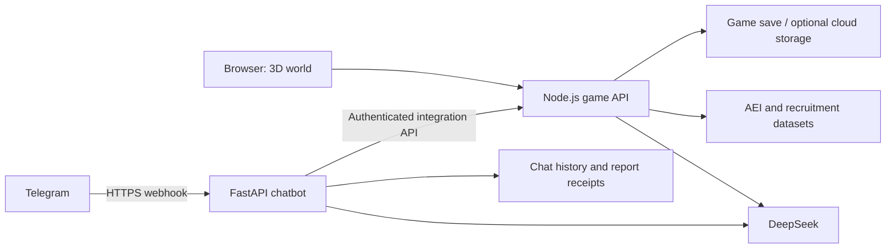

# CareerCraft

> Craft your career, one skill at a time.

An AI-assisted career exploration and learning platform that helps students understand their skill gaps and adapt their learning to different AI futures, inside a playable 3D world.

---

## Submission

- Entered in the **Open Innovation** track of AITEX Summit Fall 2026 (*From Prompt to Product*, 21–23 Nov 2026)
- Play it in the browser: **https://careercraft-six.vercel.app**

> The live demo runs in mock-AI mode (`AI_MOCK=1`) with shared game saves on serverless Postgres. The reachability of a public URL does not prove 3D rendering, successful AI calls, or data durability.

---

## Overview

### Problem

Students often know a career title without knowing which skills to learn next. Recruitment information, personal ability and learning progress are scattered across different tools. AI-driven changes add uncertainty: students need a way to compare assumptions and revise their plans as they learn.

### Solution

CareerCraft connects a student's profile, recruitment evidence, career matching and an actionable learning roadmap inside a playable 3D world. Deterministic rules calculate career scores and skill priorities; AI helps interpret profiles, explain evidence and write learning tasks. Moderate and Extreme scenarios help students compare learning priorities under different assumptions, while check-ins and Telegram learning reports support continued progress.

### Key Features

1. **Profile** — Build an editable skill profile from a CV, experience or manually entered skills.
2. **Signals** — Explore dated recruitment samples, skill demand and source coverage. Missing or simulated data must be interpreted with their limitations.
3. **Match** — Compare skills with career requirements and inspect the gaps behind a recommendation.
4. **Pathway** — Follow ordered learning tasks and resources, review learning at weekly check-ins, and verify Telegram learning reports with short quizzes. Check-ins can propose adjustments to the next learning tasks.
5. **SDGs** — Connect career skills to specific Sustainable Development Goal targets. Preparation indicators do not measure actual social impact.
6. **Scenarios** — Compare Moderate and Extreme AI-adoption assumptions and adapt learning priorities. AEI describes task-level AI use; scenario scores are estimates, not guarantees about employment or skill obsolescence.

The interface supports English, Chinese and Malay, with career pets, mentor conversations and a replayable beginner tour. Expert characters use AI interpretations of documented perspectives; they are not the real people.

### Tech Stack

| Layer | Technology |
| --- | --- |
| Frontend | JavaScript ES modules, Three.js, WebGPU/WebGL 2, Rapier, GSAP, Howler, Stylus, Vite |
| Backend | Node.js HTTP game API; separate Python FastAPI/Uvicorn chatbot |
| Database | Default deployment: JSON game saves and SQLite chatbot storage on ephemeral filesystems. Optional PostgreSQL/AWS storage is implemented but not enabled by default. |
| AI / Compute | DeepSeek for the game and Telegram chatbot; optional self-hosted vLLM via a RunPod provider adapter |
| Data / Integrations | Anthropic Economic Index, recruitment samples and reference datasets; optional crawler and n8n workflows |
| Hosting / Dev | Node web services (Render configuration provided) and GitHub |

---

## Project Structure

```text
.
├── docs/                         # Architecture, deployment, screenshots and records
│   ├── architecture.md
│   ├── render-deployment.md
│   └── reference/README.md       # Upstream provenance (folio-2025)
├── src/
│   ├── game/                     # Three.js frontend and Node.js backend
│   │   ├── server/index.js       # Production game/API entry point
│   │   ├── sources/              # Frontend source
│   │   └── static/               # Runtime models, textures and audio
│   ├── chatbot/                  # Telegram/WhatsApp companion
│   │   ├── run.py                # Python service entry point
│   │   ├── app/
│   │   └── scripts/              # Telegram webhook registration
│   ├── crawler/                  # Optional recruitment collection service
│   ├── aws/                      # Optional cloud persistence backend
│   ├── data/                     # Data processing, mappings and historical inputs
│   ├── expert/                   # Runtime mentor reference cards
│   ├── assets/                   # Editable environment source assets
│   ├── character/                # Editable character assets
│   ├── model/                    # Source models
│   ├── scripts/                  # Maintenance utilities
│   └── tools/                    # Verification and reference-viewing tools
├── data/                         # Runtime AEI, market and reference datasets
├── api/                          # Vercel serverless entry for the game API
│   └── [...path].js              # Routes /api/* to src/game/server/app.js
├── runpod/                       # Optional self-hosted vLLM provider adapter
├── tests/                        # Game, chatbot, crawler, data and AWS suites
├── .env.example                  # Public game environment example
├── .gitignore
├── render.yaml                   # Two free Render services
├── render.persistent.yaml        # Paid opt-in persistent deployment
├── vercel.json                   # Static frontend deployment config (see below)
├── package.json                  # Root development/build/test commands
├── requirements.txt              # Shared Python dependency entry point
├── LICENSE
└── README.md
```

Runtime `data/` and module paths are retained because the game imports them directly. Local `.env`, saves, databases, caches and dependencies are excluded from Git.

### Architecture



See [architecture and service boundaries](docs/architecture.md). The game and chatbot run as separate services. The optional crawler and n8n schedules require separate setup.

---

## How to Run

### Run Locally

Requirements: **Node.js 24+**, npm, a hardware-accelerated browser with WebGPU or WebGL 2, and Python 3.11+ for the optional companion/data tools.

From the repository root:

```bash
npm ci
npm ci --prefix src/game
cp .env.example src/game/.env
# Edit src/game/.env: use AI_MOCK=1 or supply your private AI credentials.
npm run dev
```

Open **http://localhost:5000**. In PowerShell, use `Copy-Item .env.example src/game/.env` and `npm.cmd` if script execution policy blocks `npm`. Restart after changing environment variables.

For the production game server:

```bash
npm run build
npm start
```

It defaults to **http://127.0.0.1:8787**. Cloud services use their assigned `PORT` and `HOST=0.0.0.0`.

For the Telegram companion, use a separate terminal from the repository root.
Create and activate a virtual environment:

```bash
python -m venv .venv
source .venv/bin/activate
```

In PowerShell, replace the `source` command with `.\.venv\Scripts\Activate.ps1`.
Then install dependencies, configure the companion and start it:

```bash
python -m pip install -r requirements.txt
cp src/chatbot/.env.example src/chatbot/.env
# Configure Telegram, DeepSeek, CAREERCRAFT_API_URL and matching INTEGRATION_TOKEN.
python src/chatbot/run.py
```

In PowerShell, use `Copy-Item src/chatbot/.env.example src/chatbot/.env` for the
copy step. If activation is blocked by execution policy, use
`.\.venv\Scripts\python.exe` in place of `python` for installation and startup.
The local companion's health URL is **http://127.0.0.1:8000/health** unless `PORT`
is overridden. It runs separately from the game server.

Use `CAREERCRAFT_API_URL=http://localhost:5000` with the local dev game, or the deployed game HTTPS URL in the cloud. Set exactly one `TELEGRAM_ALLOWED_USER_IDS` for learning verification and `/expert`. Both services must share `INTEGRATION_TOKEN`. Webhook registration requires the chatbot's public HTTPS URL, not localhost. Follow the [Render/webhook guide](docs/render-deployment.md).

Optional recruitment sampling: [crawler setup](src/crawler/README.md). Optional cloud storage: [AWS guide](src/aws/README.md). Optional self-hosted inference: [RunPod vLLM provider](runpod/README.md). The game uses a shared save; separate authenticated multi-user accounts remain future work.

### Run Tests

```bash
npm --prefix src/game test                  # Game API, UI helpers and workflows
npm ci --prefix src/crawler
npm test                                   # All Node suites
npm run test:python                        # After installing requirements.txt in .venv
```

The [test guide](tests/README.md) lists the isolated suites and browser requirements. Offline tests use synthetic inputs and mocked providers. Deployment health checks do not prove GPU rendering or real Telegram command outcomes.

---

## Deployment

### Render

[`render.yaml`](render.yaml) describes two web services (the Node game and the Python chatbot). [`render.persistent.yaml`](render.persistent.yaml) adds a durable-storage opt-in. See [deployment details](docs/render-deployment.md). Free service filesystems are temporary: idle services can sleep, and local JSON/SQLite data can be lost on restart, redeploy or spin-down.

### Vercel

The project is deployed on Vercel and live at **https://careercraft-six.vercel.app**.

CareerCraft runs on Vercel as a **static frontend + one serverless function**. [`vercel.json`](vercel.json) builds the Vite frontend to `src/game/dist` and routes every `/api/*` request to [`api/[...path].js`](api/[...path].js), which reuses the same router as the standalone server. Game saves use Postgres (set `DATABASE_URL`), since the serverless filesystem is ephemeral.

See the full guide, required environment variables, and caveats (notably function-duration limits for slow AI calls) in [docs/vercel-deployment.md](docs/vercel-deployment.md). The Python Telegram chatbot is a separate service and is not part of the Vercel deploy. For the full stack unchanged (including the chatbot), Render (above) remains the simplest path.

---

## Challenges & Learnings

- **Evidence quality:** Recruitment samples have incomplete coverage; simulated history and imputed skill values must not be described as observed vacancies or AI measurements.
- **AI uncertainty:** Scenario parameters are planning assumptions. Task exposure cannot establish that an entire career will disappear.
- **Adaptive learning:** Replanning must preserve existing progress and skill foundations. A completed checkbox or self-report alone does not certify mastery.
- **Deployment boundaries:** A Node web service does not run Python automatically. Telegram needs its own service, matching authentication and a fixed HTTPS webhook.
- **Persistence:** Free service filesystems are temporary. Cloud persistence requires an explicitly configured database or paid disk, plus migration and restart verification.

## Future Improvements

- [ ] Enable always-on services and durable game/chatbot storage.
- [ ] Add authenticated accounts and isolated per-user saves.
- [ ] Gather more comparable recruitment observations across regions and seniority levels.
- [ ] Validate roadmap usefulness with students and career advisers.
- [ ] Improve accessibility and performance on lower-powered devices.

## License

This repository includes an [Apache License 2.0](LICENSE). The game foundation is adapted from Bruno Simon's *folio-2025* and retains its [MIT license notice](src/game/license.md). Third-party code, datasets and assets retain their respective licenses; see [upstream provenance](docs/reference/README.md).
